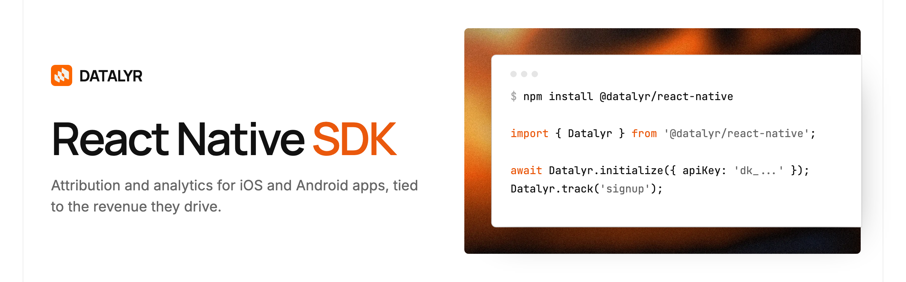

<picture>
  <source media="(prefers-color-scheme: dark)" srcset=".github/assets/banner-dark.png">
  
</picture>

<p align="center">
  <a href="https://www.npmjs.com/package/@datalyr/react-native"></a>
  <a href="https://github.com/datalyr/react-native/actions/workflows/ci.yml"></a>
  <a href="LICENSE"></a>
  <a href="https://docs.datalyr.com/sdk-reference/react-native"></a>
</p>

# DATALYR React Native SDK

Track your React Native or Expo app with DATALYR and see which channel, campaign and ad drove every install and purchase.

- **Attribution.** Installs are tied to the ad click, Apple Search Ads or the Play install referrer.
- **One customer, every device.** Anonymous app activity joins the signed-in user when you call `identify()`.
- **Better ad signal.** Conversions reach your ad platforms, with SKAdNetwork values set for you on iOS.
- **Privacy built in.** App Tracking Transparency is respected, and the SDK ships an Apple privacy manifest.

## Install

Use the option that matches your app.

**Bare React Native:**

```bash
npm install @datalyr/react-native expo-modules-core @react-native-async-storage/async-storage@^2 react-native-get-random-values
npx install-expo-modules@latest
cd ios && pod install
```

The SDK is built on Expo Modules. You must install `expo-modules-core` in a bare app too. AsyncStorage and `react-native-get-random-values` are native modules: React Native links only the packages your app lists, so install them in your app.

`react-native-get-random-values` 2.x works only on React Native 0.81 or later with the New Architecture on. On an older React Native, or with the New Architecture off, install `react-native-get-random-values@^1` instead. 2.x installs there without a warning, but its iOS native module is registered only for the New Architecture, so the SDK fails at start and sends no events.

**Expo:**

```bash
npx expo install @datalyr/react-native expo-application expo-device expo-network @react-native-async-storage/async-storage react-native-get-random-values
```

`npx expo install` picks the `react-native-get-random-values` version your Expo SDK expects. If you add it another way, use 2.x only on Expo SDK 54 or later with the New Architecture on; otherwise install `react-native-get-random-values@^1`.

Add the config plugin to `app.json`:

```json
{
  "expo": {
    "plugins": [
      ["@datalyr/react-native", {
        "networks": ["meta", "tiktok"],
        "trackingUsageDescription": "We use this to measure ad performance."
      }]
    ]
  }
}
```

Use a development build (`npx expo run:ios` or EAS). Expo Go ignores the plugin and sends events only.

Find your API key in DATALYR under **Settings → API**. The key starts with `dk_`.

## Quick start

```typescript
import { Datalyr } from '@datalyr/react-native';
// Expo: import { Datalyr } from '@datalyr/react-native/expo';

await Datalyr.initialize({ apiKey: 'dk_your_api_key' });

// Installs, app updates and sessions are tracked for you.

// Track an action
await Datalyr.track('signup_started', { plan: 'pro' });

// Tie the device to your user after sign-in
await Datalyr.identify('user_123', { email: 'user@example.com' });

// Record a conversion with its value
await Datalyr.trackPurchase(49.0, 'USD', 'pro_monthly');

// On logout only
await Datalyr.reset();
```

## Check it works

1. Install the app on a clean simulator or a fresh device.
2. In DATALYR, open **Events**.
3. Confirm that `app_install` and `session_start` arrive within 30 seconds.

If no event arrives, add `debug: true` to `initialize()`. Then read the Metro console.

## Set up with an AI agent

Your AI agent can install the SDK for you. Connect the agent to the DATALYR MCP server at `https://mcp.datalyr.com/mcp`. Then ask it to install tracking. See [DATALYR MCP](https://docs.datalyr.com/datalyr-mcp).

## Documentation

- [React Native SDK reference](https://docs.datalyr.com/sdk-reference/react-native): every method, option and event
- [Changelog](CHANGELOG.md)
- Other SDKs: [Web](https://github.com/datalyr/web) · [iOS (Swift)](https://github.com/datalyr/swift) · [Node](https://github.com/datalyr/api)

## Support

- Bugs and feature requests: [open an issue](https://github.com/datalyr/react-native/issues/new/choose)
- Security reports: see [SECURITY.md](SECURITY.md)
- Other questions: [datalyr.com](https://datalyr.com)

## License

MIT. See [LICENSE](LICENSE).
